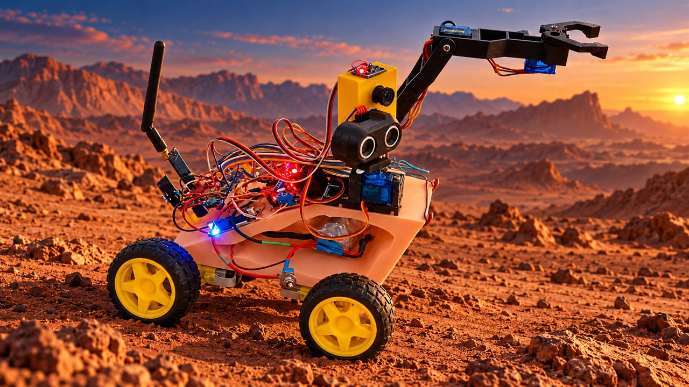

# HuginnRover

## Vídeo de apresentação — versão 1.0

Conheça o HuginnRover 1.0 no vídeo de apresentação do projeto. Clique na capa para assistir no YouTube.

[Assistir ao vídeo no YouTube](https://youtu.be/AYv1k4ATDqQ)

*Capa artística editada com IA a partir de uma foto do rover; o cenário de Marte é ilustrativo.*

**Plataforma robótica móvel, modular e expansível — projeto em desenvolvimento.**

HuginnRover é um projeto pessoal de robótica com foco em baixo custo, alcance de comunicação, interfaces e capacidade de receber novas funções por meio de hardware e software desenvolvidos e integrados ao longo do tempo. A intenção é construir e entender o sistema de ponta a ponta, registrando resultados reais e limitações.

O nome foi escolhido pelo autor em 2026-10-17. O projeto ainda não tem uma licença open source definida.

## Estado atual

Este repositório começa como estrutura de organização e documentação. Ainda não contém firmware, esquemáticos, pinagens confirmadas, modelos 3D ou resultados de testes. Os diretórios estão preparados para receber esses materiais quando forem fornecidos e verificados.

Os itens abaixo são ideias ou componentes considerados pelo autor; esta lista **não afirma que estejam instalados, integrados ou testados**:

- microcontrolador da família RP2040;
- comunicação por Wi-Fi local, Bluetooth, LoRa e nRF;
- câmera desenvolvida/integrada ao projeto;
- sensores ultrassônico, MPU6050 e radar mmWave HLK-LD2450 (24 GHz);
- um ou mais braços manipuladores.

O usuário descreveu a aparência atual como semelhante ao robô WALL·E. Essa é uma referência visual relatada pelo autor, não uma especificação mecânica publicada.

## Estrutura

| Caminho | Conteúdo esperado |
|---|---|
| `firmware/rover/` | Código do robô móvel |
| `firmware/controller/` | Código do controle |
| `firmware/common/` | Protocolos e componentes compartilhados |
| `hardware/gpio/` | Tabelas de GPIO verificadas para as placas reais |
| `hardware/schematics/` | Esquemáticos e diagramas elétricos |
| `hardware/bom/` | Lista de materiais, versões e fontes |
| `mechanical/cad/source/` | Arquivos-fonte de CAD |
| `mechanical/cad/stl/` | Exportações STL para impressão 3D |
| `mechanical/cad/step/` | Exportações STEP para intercâmbio CAD |
| `docs/technical-history.md` | Histórico técnico com datas e evidências |
| `media/photos/` e `media/videos/` | Registros visuais próprios do projeto |

## Como os resultados serão registrados

Cada teste deve indicar configuração, data, método, resultado observado e limitações. Compilação, teste de bancada e validação física serão registrados separadamente. Alcance, taxa de quadros e outras métricas só serão publicados como resultados quando houver medições e condições de teste documentadas.

## Contribuições e licença

Este repositório é público. Até que uma licença seja escolhida e adicionada, não presuma permissão para reutilizar, modificar ou redistribuir o conteúdo. Veja [`docs/licensing.md`](docs/licensing.md).

## Idioma

A documentação inicial está em português. Uma versão em inglês poderá ser adicionada depois.
